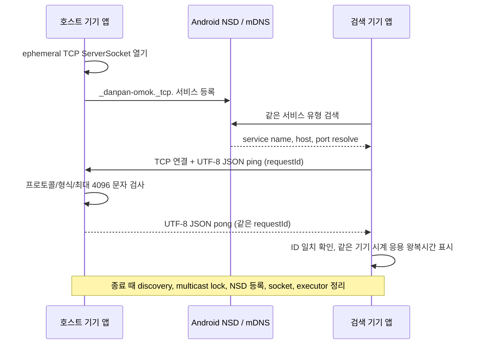

# Android 구조 선택과 LAN 연결 시제품

작성: 2026-11-13 (Asia/Seoul). 기존 PWA·소스·lockfile은 유지한다. 이 단계는 Android 로컬 호스트/NSD/TCP 왕복 경로만 다룬다. 전체 게임 이식, APK 설치, 실제 Android 기기 시험은 완료된 것으로 취급하지 않는다.

## 구조 비교와 선택

| 고려점 | React/TypeScript + Android WebView | Kotlin 네이티브 |
|---|---|---|
| 기존 화면·스타일 | React 화면과 CSS를 높은 비율로 재사용. WebView asset origin, 키보드/viewport, 접근성은 Android에서 재검증해야 함 | 화면을 Android UI로 다시 작성. 기존 디자인과 동작은 기준 자료로 활용 |
| 규칙·봇 | shared 규칙·봇을 JS에서 재사용 가능. Worker/메시지 수명과 WebView 종료/복구를 검증해야 함 | 규칙·봇을 이식하고 기존 TypeScript 테스트의 입력·출력과 대조해야 함 |
| 자동 검색·호스트 | `NsdManager`, TCP 서버는 Kotlin API로 제공하고 WebView와 비동기 브리지를 설계해야 함 | `NsdManager`와 socket을 직접 사용. 브리지 없이 OS 오류·중단·정리를 처리할 수 있음 |
| SQLite | Node `better-sqlite3`는 그대로 쓸 수 없음. Android 저장소와 WebView 명령 어댑터가 필요 | Android SQLite/Room 계층으로 변환. 기존 스키마와 트랜잭션 정책은 참고 가능 |
| 백그라운드·종료 | WebView lifecycle과 Android foreground 제한을 둘 다 맞춰야 함 | Activity/service 생명주기에서 호스트 종료 정책을 직접 다룰 수 있음. 지속 호스트는 향후 foreground service 적합성 검토 필요 |
| PNG 저장 | 기존 Canvas 렌더를 활용하되 다운로드를 Android 공유/MediaStore로 연결 | 결과 이미지를 Android 저장/공유 API로 생성하거나 기존 캔버스 출력 기준을 이식 |
| 유지보수 | UI와 순수 TS 정책 재사용 이득이 큼. 네이티브 기능과 웹 런타임의 경계가 생김 | Android 코드가 일관되지만 기능 이중 구현·회귀 대조 비용이 큼 |
| 현재 환경에서의 빌드 | Android WebView는 기본 API지만 React asset 제작/동기화·브리지가 추가됨 | 설치된 SDK36/JDK17 및 로컬 캐시의 AGP 8.13.2 조합을 사용 가능. 이번 환경의 Gradle build 실행에는 별도 loopback 장애가 관찰됨 |

**제품 구조 선택: 하이브리드.** 기존 React/TypeScript 화면·순수 규칙·봇을 재사용하고, Kotlin 계층이 NSD/TCP, Android lifecycle, SQLite, 권한, PNG 저장을 담당한다. WebView에서 임의 LAN 주소로 직접 연결하지 않고 Kotlin LAN 계층을 좁은 요청/응답 계약으로 노출한다. Node 서버와 `better-sqlite3`를 Android에서 실행하는 구조는 선택하지 않는다.

이번 시제품은 WebView를 붙이기 전 연결 위험을 격리해 확인하는 **임시 네이티브 화면**이다. 연결 성공 여부가 확인되기 전에는 게임 화면이나 저장소를 이식하지 않는다. 이후 하이브리드 화면과 LAN 계층 통합 시 JS bridge는 허용된 앱 자원에서만 노출하고, 페이지의 임의 탐색·원격 콘텐츠에는 노출하지 않는다.

### 확정된 빌드 조합

| 설정 | 고정값 | 근거와 범위 |
|---|---|---|
| Android Studio | 기존 설치 2026.2.2 유지 | 0단계에서 실제 설치 버전 확인. IDE/JBR 변경 없음 |
| Gradle JDK | Microsoft OpenJDK 17.0.21.0.2 | 실제 실행한 JDK 경로. IDE JBR 25.0.4와 구별. 프로젝트 빌드 명령은 이 JDK를 명시 |
| Gradle Wrapper | 8.13 | AGP 8.13.2의 공식 기본/필요 버전. Wrapper distribution SHA를 고정 |
| AGP | 8.13.2 | 설치 Android Studio 호환 범위와 SDK36을 사용. AGP8.13 공식 기준 Gradle8.13/JDK17/Build Tools35 |
| Kotlin Gradle Plugin | 2.3.10 | 공식 KGP 호환표의 Gradle 7.6.3–9.0, AGP 8.2.2–9.0 범위에 AGP8.13.2와 Gradle8.13이 포함됨 |
| compile/target SDK | 36 / 36 | 설치된 android-36 사용. Android 17 API37 권한을 선언·요청하는 빌드가 아님 |
| Android Build Tools | 35.0.0 | AGP8.13 공식 기본/필요 버전이며 0단계에서 실제 설치 확인 |
| min SDK / JVM target | 23 / 17 | NSD API가 더 오래된 Android에도 있지만 이 시제품을 위한 임시 하한. 실제 대상 기기 범위는 아직 조사 전 |

이 조합은 **버전 고정**이지 빌드 성공 판정이 아니다. 프로젝트에 Wrapper `--version`을 실행해 Gradle 8.13과 Launcher/Daemon JDK17을 실제 확인했다. `assembleDebug`는 Gradle daemon loopback 소켓 생성 실패로 중단돼 compiler/API 호환과 APK는 미검증이다. Studio의 프로젝트별 UI Gradle JDK는 앱을 열어 대조하지 않았으므로 사용자는 Gradle JDK를 Microsoft JDK17로 설정해야 한다.

## Android 로컬 네트워크 권한 정책

시제품은 Android API 23 이상에서 `INTERNET`, `ACCESS_NETWORK_STATE`, `ACCESS_WIFI_STATE`, `CHANGE_WIFI_MULTICAST_STATE`를 선언한다. 인터넷 자체는 사용하지 않는다. Wi-Fi `NetworkCallback`을 구독하고 호스트를 Wi-Fi IPv4에만 bind하며 상대 socket은 해당 Wi-Fi network factory로 생성한다. 이는 기기가 Wi-Fi와 이동통신을 함께 보유할 때 local route를 분명히 하기 위한 구현 선택이다. mDNS 검색 중 multicast lock을 획득해 검색 종료/화면 파괴 때 해제한다.

| 기기/API와 target | 현재 동작·요구 |
|---|---|
| Android 12/API32 이하 | 이번 NSD 사용은 Wi-Fi Direct/설정 변경이 아니다. 위치 권한을 요청하지 않는다. foreground NSD multicast 수신에 lock을 사용한다. 실제 구형 기기 확인은 미실행 |
| Android 13/API33–15/API35, target36 | NSD 검색을 위해 `NEARBY_WIFI_DEVICES`를 무조건 요구하지 않는다. 앱이 Wi-Fi 연결을 직접 관리하거나 Wi-Fi Direct를 쓰는 경로가 아니기 때문이다. 다른 API 추가 시 권한 재검토 |
| Android 16/API36, target36 | 일반 설치 상태에서 새 local-network 보호는 opt-in. 개발자가 compatibility flag `RESTRICT_LOCAL_NETWORK`를 켜 시험하면 해당 보호의 테스트 안내에 맞는 Nearby devices 권한 동작을 별도 검증해야 함. 이 시제품은 opt-in하지 않음 |
| Android 17/API37 이상, target36 | 공식 전환 문서는 target36 이하 앱에 `INTERNET` 기준 임시 implicit local-network grant가 있다고 설명한다. 이 target을 계속 올리지 않고 안전하다고 간주하지 않는다 |
| Android 17/API37 이상, target37 이상으로 올릴 때 | `ACCESS_LOCAL_NETWORK`를 manifest에 선언하고 runtime permission을 요청하거나, 사용자 시스템 service picker 경로로 재설계해야 한다. 자동 검색 후 자체 상대 목록을 보여주는 요구는 broad permission 경로를 선택할 가능성이 높다. 거부/회수면 검색·연결을 막고 권한 설명과 설정 이동을 제공한다 |

이번 화면은 NSD/TCP에서 `SecurityException`이 발생하면 권한 거부 또는 OS 정책 차단 가능성을 설명한다. API37 target permission 요청 UI는 target36 시제품에 억지로 추가하지 않았다. API37 target 빌드로 올릴 때 manifest와 runtime dialog를 함께 구현한다. 게스트 Wi-Fi/AP isolation은 앱 권한으로 우회할 수 없으며 같은 일반 Wi-Fi, 기기 간 통신 허용을 안내한다.

근거: [Android local network permission, Android 17 enforcement](https://developer.android.com/privacy-and-security/local-network-permission), [NsdManager API: discovery, multicast lock and API37 behavior](https://developer.android.com/reference/android/net/nsd/NsdManager), [Wi-Fi permissions](https://developer.android.com/develop/connectivity/wifi/wifi-permissions), [Android 13 nearby Wi-Fi behavior](https://developer.android.com/about/versions/13/behavior-changes-13), [Network-specific socket factory](https://developer.android.com/reference/android/net/Network), [AGP 8.13 release notes](https://developer.android.com/build/releases/agp-8-13-0-release-notes), [Kotlin Gradle compatibility](https://kotlinlang.org/docs/gradle-configure-project.html), [Gradle Java compatibility](https://docs.gradle.org/8.13/userguide/compatibility.html).

## 현재 시제품 연결 경로

기본 포트는 OS가 동적으로 할당하며 사용자 입력 UI는 없다. 서비스 이름은 임의 접미사로 로컬 이름 충돌을 줄인다. 한 Activity/controller 안에서 호스트 시작은 단일 소유자로 잠그고, 한 연결 중복 요청은 거절한다. 호스트는 여러 기기에서 동시에 각각 실행될 수 있으며, 게임 신청·호스트 권위·닉네임·세션·SQLite는 아직 구현하지 않았다. 시제품은 평문 LAN 진단 ping/pong이며 실제 게임 프로토콜·암호화·인증으로 간주하지 않는다.

화면의 ‘연결·검색 종료’와 Activity 파괴는 discovery listener, multicast lock, NSD service, socket, executor를 정리한다. foreground Activity가 종료되면 호스트도 종료한다. 호스트를 화면 밖에서 유지하는 서비스 정책은 다음 단계에서 결정한다. 접속자 목록에 서비스 자체 호스트를 노출하지 않고 발견한 서비스 이름으로 선택한다. 이 항목은 요구사항의 닉네임/신청 UI와 별개다.

## 다음 검증 게이트

1. Windows에서 Wrapper를 쓰는 Gradle build가 loopback 오류 없이 실행 가능한 JVM/IDE 설정을 찾고, `:app:assembleDebug` 및 manifest/target 권한을 확인한다.
2. AVD 또는 단일 기기에서 앱 시작·Wi-Fi 없음 안내·NSD 등록/검색·해제 경로를 기록한다. 에뮬레이터 결과는 실기와 분리한다.
3. 실제 Android 두 대의 같은 Wi-Fi에서 호스트 중복·상대 선택·ping/pong·재연결·서비스 정리, 게스트망 실패를 확인한다.
4. 연결 경로가 재현되기 전에는 게임 규칙·온라인 화면·SQLite·PNG 통합을 진행하지 않는다.

실제 기기/화면 캡처는 아직 없다. 빌드/환경 명령 원문은 [android-lan-prototype.json](evidence/android-lan-prototype.json)에 기록한다.

## 이후 Android WebView 통합 작업 — 2026-11-13

위 시제품 이후 `MainActivity`를 React 앱 자산을 담는 Android WebView host로 바꾸고, 기존 홈/혼자 놀기 화면과 `NativeLanScreen`을 연결했다. LAN Kotlin 계층은 그대로 진단용이며 실제 게임 세션/신청/착수 동기화는 아니다. 앱 자산은 `apps/web/dist`를 Android main assets root로 추가하고, trusted app asset URL만 `AssetManager`에서 읽는다. `AssetManager` 경로를 실제 source root 배치와 맞추어 `web/` prefix 없이 열도록 교정했다. WebView 외부 탐색/외부 resource 차단, DOM storage, JS interface 제한은 코드상 적용했다.

혼자 놀기 화면은 기존 `packages/shared` 규칙과 `apps/web/src/bot-runner.ts` Worker를 사용한다. H8 시작, 2초 deadline, legal fallback, gameId/revision/taskId 유효성, `localStorage` 상태 복구/초기화는 기존 TS 구현이며 규칙·봇 사례 117개가 전체 자동 시험 안에서 통과했다. 이는 실제 Android WebView Worker·저장 수명·키보드 시험을 대신하지 않는다.

현재 실제 결과: 고정 Node/npm typecheck 성공, 23개 테스트 파일/117개 테스트 성공, Vite Android asset build 성공. Gradle APK build는 JDK17 환경에서 loopback pipe 오류로 실패했고 APK 미생성. adb 장치 0, AVD `Medium_Phone_API_37.0`은 목록만 있고 미실행. 따라서 Android 빌드·설치·화면·Worker·복구·NSD/TCP 실행은 미검증 상태다. 최신 명령과 실제 종료 결과는 [android-hybrid-stage.json](evidence/android-hybrid-stage.json), 인수 기준은 [acceptance.md](acceptance.md)에 기록한다. 본 절의 1단계 시제품 계획은 역사 기록으로 유지되며 이후 소스 통합을 Android 런타임 완료로 간주하지 않는다.
